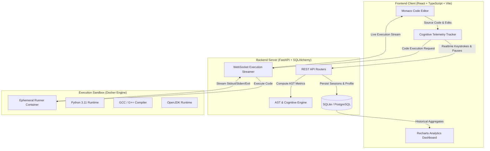

<div align="center">

# 🧠 Adaptive Cognitive Analyzer

**An intelligent development environment designed to monitor, audit, and optimize a developer's cognitive coding rhythm in real time.**

[](LICENSE)
[](https://www.python.org/)
[](https://fastapi.tiangolo.com/)
[](https://react.dev/)
[](https://www.typescriptlang.org/)
[](https://vitejs.dev/)
[](https://www.docker.com/)

[Key Features](#-key-features) •
[System Architecture](#-system-architecture) •
[Cognitive Telemetry](#-cognitive-telemetry-engine) •
[Quickstart](#-quickstart) •
[Manual Setup](#-manual-setup) •
[API Reference](#-api--websocket-reference) •
[Testing](#-testing--quality-assurance)

---

</div>

## 📖 Overview

**Adaptive Cognitive Analyzer** is a local development environment and cognitive audit suite that analyzes developer typing dynamics, structural Abstract Syntax Tree (AST) complexity, and execution patterns in real time. 

Traditional linters only judge syntax correctness; Adaptive Cognitive Analyzer bridges the gap between **how code is written** and **how a developer thinks**, measuring cognitive load, pause bursts, algorithmic branching, and editing velocity to produce an actionable developer intelligence profile.

---

## 🚀 Key Features

* **⚡ Real-Time Cognitive Telemetry**: Captures keypress cadence, typing velocity (Words Per Minute), pause latency spikes (thinking vs. distraction), and backspace correction ratios as you write.
* **🔬 Deep AST & Algorithmic Complexity Audits**: Evaluates cyclomatic complexity, maximum nesting depth, loop density, recursion presence, and Halstead maintainability indices across Python, C, C++, and Java.
* **🛡️ Sandboxed Code Execution Engine**: Executes arbitrary code safely inside isolated ephemeral Docker containers with strict memory, CPU, and execution timeout quotas (with native local fallback).
* **📊 Comprehensive Analytics Dashboard**: Visualizes developer readiness scores, cognitive load timelines, radar competency charts (readability, efficiency, security, maintainability, optimization), and historical session trends.
* **💻 Offline-Ready Monaco Editor Integration**: Incorporates a localized Monaco Editor core (VS Code engine) running 100% locally with zero CDN or external network dependencies.
* **⚡ One-Click IDE Automation**: Bundles cross-platform VS Code / Antigravity workspace tasks to automatically provision virtual environments, install packages, and spin up dual services with a single shortcut (`Ctrl+Shift+B`).

---

## 🏛️ System Architecture



---

## 🧠 Cognitive Telemetry Engine

Adaptive Cognitive Analyzer evaluates developers across multiple physiological and algorithmic dimensions:

| Metric | Measurement Paradigm | Cognitive Interpretation |
| :--- | :--- | :--- |
| **Typing Velocity (WPM)** | Words typed per active typing minute | Flow state indicator & implementation speed |
| **Pause Latency Spikes** | Inactivity periods $\ge 2.0\text{s}$ | Algorithmic formulation, problem solving, or cognitive block |
| **Correction Ratio** | Backspaces / Total keystrokes | Code confidence, certainty, and refactoring frequency |
| **Cyclomatic Complexity ($M$)** | $M = E - N + 2P$ (AST nodes) | Mental overhead required to trace execution paths |
| **Maintainability Index ($MI$)** | Halstead Volume + Cyclomatic + LOC | Long-term readability and sustainability of solutions |
| **Cognitive Readiness Score** | Multi-variable weighted index | Developer qualification level: Beginner, Intermediate, or Advanced |

---

## 🛠️ Technology Stack

| Layer | Technologies |
| :--- | :--- |
| **Frontend Core** | React 18, TypeScript 5, Vite 5, Tailwind CSS |
| **Editor** | Monaco Editor (VS Code core, fully offline bundled) |
| **Visualizations** | Recharts, Lucide Icons |
| **Backend Core** | Python 3.11+, FastAPI, Uvicorn, Pydantic v2 |
| **Data & ORM** | SQLAlchemy, SQLite (Development), PostgreSQL (Production) |
| **Analysis** | Python `ast`, Radon (Complexity & Maintainability), Regex Tokenizers |
| **Isolation** | Docker Engine, Ephemeral Sandboxes |
| **Testing** | Pytest, TestClient, Vitest |

---

## 📂 Project Structure

```
Adaptive-Coding-Analyzer/
├── .github/
│   ├── ISSUE_TEMPLATE/
│   │   ├── bug_report.md          # Standard bug report template
│   │   └── feature_request.md     # Feature proposal template
│   ├── pull_request_template.md   # Standard PR submission template
│   └── workflows/
│       └── ci.yml                 # Automated CI (Pytest & Frontend build)
├── .vscode/
│   ├── settings.json              # Python interpreter & linter configurations
│   └── tasks.json                 # Automatic build & one-click run tasks
├── backend/
│   ├── app/
│   │   ├── api/routers/           # Sessions, execution & analytics routers
│   │   ├── core/                  # Database connections & logging configs
│   │   ├── models/                # SQLAlchemy domain entities & Pydantic schemas
│   │   ├── services/              # AST intelligence & Docker execution services
│   │   └── main.py                # FastAPI application entrypoint
│   ├── data/                      # Local SQLite database & persistence
│   ├── tests/                     # Comprehensive Pytest suite (25+ test cases)
│   └── requirements.txt           # Python dependency manifest
├── frontend/
│   ├── src/
│   │   ├── components/            # Layout, ErrorBoundary & UI elements
│   │   ├── features/              # Editor, Analytics Dashboard & Landing pages
│   │   ├── services/              # API clients & Local intelligence helpers
│   │   └── styles/                # Tailwind & design system stylesheets
│   ├── package.json               # Frontend dependencies & build scripts
│   └── vite.config.ts             # Vite configuration
├── infra/
│   └── docker/                    # Backend, frontend, and sandbox Dockerfiles
├── scripts/
│   ├── clean.py                   # Lightweight archival & cache cleaning utility
│   ├── run_backend.py             # Automatic backend bootstrapper & installer
│   ├── run_frontend.py            # Automatic frontend bootstrapper & installer
│   └── run_automation_demo.py     # End-to-end telemetry demonstration
├── docker-compose.yml             # Container orchestration
├── SAMPLE_PROGRAMS.md             # Curated benchmark algorithms across 4 languages
├── CONTRIBUTING.md                 # Development & contribution guidelines
├── LICENSE                        # MIT License
└── README.md                      # Project documentation
```

---

## ⚡ Quickstart

### Prerequisites
* **Python**: 3.11 or higher
* **Node.js**: 18.0 or higher
* **Docker Desktop**: Recommended (optional for local fallback execution)

### 🎯 One-Click Setup (VS Code / Antigravity)

1. Open this repository in **VS Code** or **Antigravity**.
2. If prompted, click **"Allow Automatic Tasks"** to let the environment configure itself.
3. Simply press **`Ctrl+Shift+B`** (or run the task **"Install and Run Tasks"**):
   * Automatically creates `.venv` and installs Python packages.
   * Installs Node modules and bundles Monaco assets locally.
   * Starts FastAPI (`http://127.0.0.1:8001`) and Vite (`http://localhost:5173`) concurrently.

---

## 💻 Manual Setup

### 1. Backend Setup

```bash
# 1. Create and activate virtual environment
python -m venv .venv

# Windows (PowerShell)
.\.venv\Scripts\Activate.ps1
# Linux / macOS
source .venv/bin/activate

# 2. Install dependencies
pip install -r backend/requirements.txt

# 3. Start development server
cd backend
uvicorn app.main:app --reload --port 8001
```
*Backend Swagger Docs:* `http://127.0.0.1:8001/docs`

### 2. Frontend Setup

```bash
# 1. Navigate to frontend
cd frontend

# 2. Install dependencies
npm install

# 3. Launch Vite dev server
npm run dev
```
*Frontend Application:* `http://localhost:5173`

---

## 🐳 Docker Deployment

To launch the entire platform inside isolated Docker containers:

```bash
docker-compose up --build
```

Services will be exposed on:
* **Frontend Web App**: `http://localhost:5173`
* **FastAPI Backend**: `http://localhost:8001`

---

## 📜 API & WebSocket Reference

### HTTP REST Endpoints

| Method | Endpoint | Description |
| :--- | :--- | :--- |
| `GET` | `/health` | System health check and Docker sandbox availability |
| `POST` | `/sessions/start` | Initialize a new monitored coding session |
| `POST` | `/sessions/end/{id}` | Finalize a session and calculate total active duration |
| `POST` | `/sessions/events/track` | Stream telemetry events (`typing`, `pause`, `backspace`) |
| `POST` | `/analysis/submit` | Run complete AST & cognitive analysis on code snippet |
| `POST` | `/predict/readiness` | Compute user readiness level (Beginner/Intermediate/Advanced) |
| `GET` | `/analytics/dashboard/{user_id}` | Fetch aggregate dashboard telemetry for analytics views |

### WebSocket Protocol (`/execution/ws/execute`)

Real-time bi-directional code execution stream:

```json
// Client Request
{
  "session_id": 1,
  "language": "python",
  "code": "print('Hello from Adaptive Cognitive Analyzer Sandbox!')"
}

// Server Stream
{ "type": "status", "content": "Preparing secure container sandbox for python..." }
{ "type": "stdout", "content": "Hello from Adaptive Cognitive Analyzer Sandbox!\n" }
{ "type": "system", "content": "Execution finished with exit code 0" }
```

---

## 🧪 Testing & Quality Assurance

Adaptive Cognitive Analyzer includes an automated test suite verifying session lifecycles, AST parsing, multi-file heuristic evaluations, and telemetry computations.

### Run Backend Tests
```bash
cd backend
python -m pytest tests/ -v
```

### Run Frontend Verification
```bash
cd frontend
npm run build
```

---

## 🧹 Maintenance & Cleanup

To clean caches, virtual environments, and temporary build outputs before archiving or moving the repository:

```bash
# Clean temporary build and cache artifacts (< 1 MB transfer size)
python scripts/clean.py

# Complete reset (removes virtual environments and node_modules)
python scripts/clean.py --all
```

---

## 🤝 Contributing

Contributions, feature requests, and bug reports are welcome! Please read our [Contributing Guidelines](CONTRIBUTING.md) to get started.

1. Fork the Project
2. Create your Feature Branch (`git checkout -b feature/NewFeature`)
3. Commit your Changes (`git commit -m 'feat: Add NewFeature'`)
4. Push to the Branch (`git push origin feature/NewFeature`)
5. Open a Pull Request

---

## 📄 License

Distributed under the **MIT License**. See [`LICENSE`](LICENSE) for more details.

---

<div align="center">

Crafted with ❤️ by **[Talla Naga Sai Charan](https://github.com/tnscharan)**

</div>